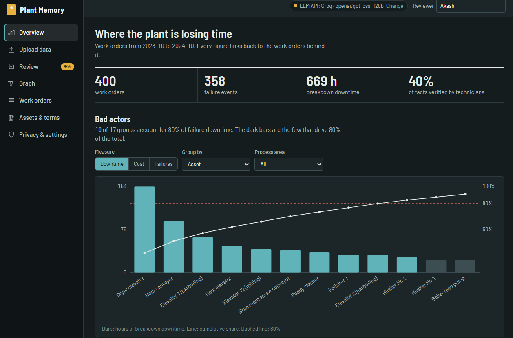
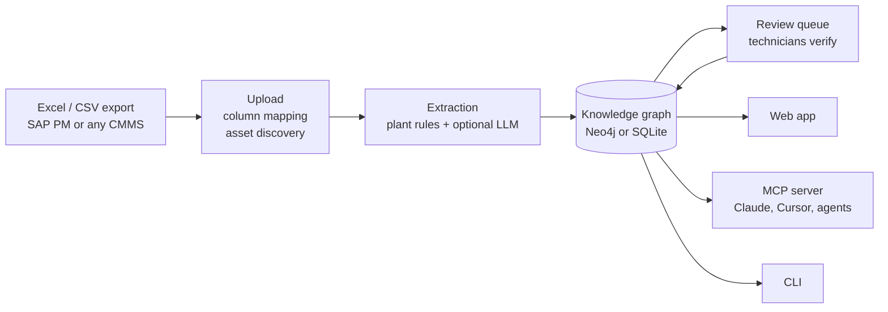
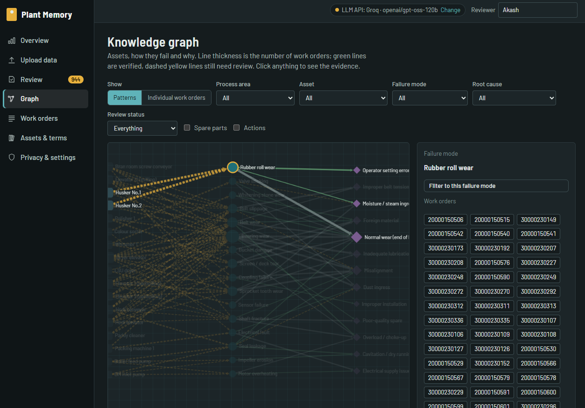
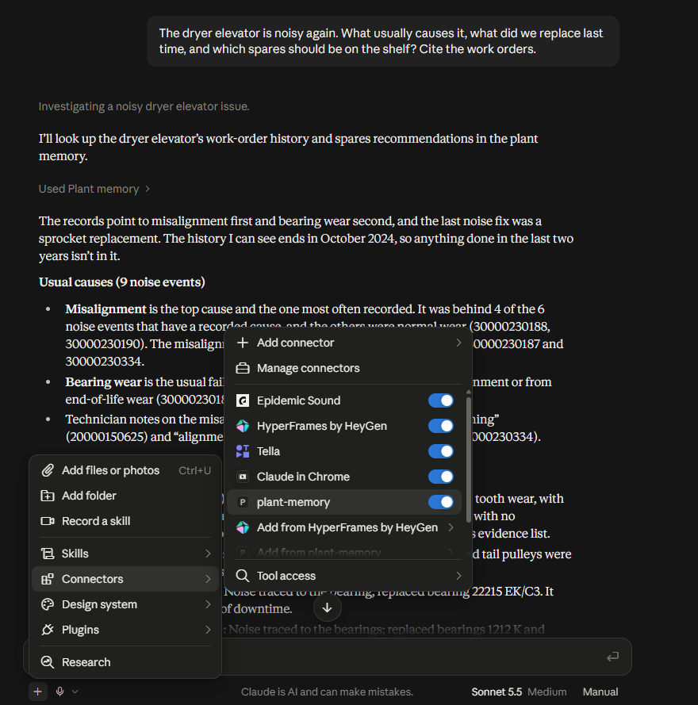

# Plant Memory

**Turn a plant's maintenance history into a verified knowledge graph that people and AI agents can both query, with every answer citing the work orders behind it.**


Upload a work-order export from SAP PM or any CMMS. Plant Memory extracts what failed, why, and what fixed it, and turns that into a graph. Technicians verify each fact before it counts. People use it through a web app, AI agents (Claude, Cursor and others) use it through an MCP server, and both work on the same graph.



---

## The problem

Most plants record which parts were used, not why the equipment failed or what fixed it. That diagnostic knowledge lives in senior technicians' heads, and it leaves when they do.

A typical SAP PM export shows the symptoms:

- **Repeat failures are invisible.** The same elevator gets three separate orders in a month (bearing, sprocket, "general maintenance") and nothing links them as one recurring problem.
- **The text isn't machine-readable.** `Parb. dryer ELevator brg chng`, `Plmbr Blck`, `modificatn`. Asset names are buried in free text with no equipment ID.
- **Work-type labels are unreliable.** Bearing replacements tagged *Preventive*, belt changes tagged *Corrective*, so cost and reliability analysis built on them is skewed.
- **Cause and fix are missing.** Cost and material are there, but symptom, root cause, downtime and action taken are not.

Plant Memory pulls that knowledge out of the work orders the plant already has, gets technicians to confirm it, and keeps it where a planner or an AI assistant can look it up.

## How it works



The web app, the MCP server and the CLI all read and write the same graph. A fact a technician verifies in the browser shows up as verified the next time Claude asks.

**Design principles**

- **Raw data is read-only.** Uploaded rows are evidence and are never edited. People change the *knowledge* (verify, correct or reject facts, edit assets and vocabulary), and every decision is logged with who made it.
- **Every answer is grounded.** Diagnoses, rankings and recommendations cite the work orders they came from, and answers backed by too few events are flagged as sparse evidence.
- **MCP tools can't change verified knowledge.** The one write tool, `submit_technician_answer`, creates a proposal that a person has to approve.
- **Plant rules come first; the LLM is a second reader.** When the two disagree, the rule's value stays and the fact moves up the review queue. The LLM only fills fields the rules left empty ([why](docs/llm_evaluation.md)).

## Features

| Screen | What it's for |
| --- | --- |
| **Upload data** | Drop an `.xlsx`/`.csv` export, map its columns, confirm the assets it found, build. New files add to the history, and the newer file wins for repeated work orders. |
| **Review** | Facts to check (lowest confidence first, each shown with the words it was read from), questions for technicians where failures repeat with no recorded cause, and new terms the vocabulary doesn't know yet. |
| **Graph** | Patterns view (assets → failure modes → root causes, weighted by work orders) and a per-work-order view. Filter by area, asset, failure mode, cause or review status, and click any edge to see its evidence or review it in place. |
| **Work orders** | Searchable table. Open an order to see the raw SAP lines next to what was extracted. |
| **Assets & terms** | Edit the asset register and vocabulary (failure modes, causes, actions, symptoms, components) to fit your plant. |
| **Overview** | Bad actors (Pareto by downtime, cost or frequency), repeat failures, spares to stock, and data-quality problems in the export. |
| **Privacy & settings** | Choose where work-order text is processed: locally only, through an LLM API, or through a local LLM. |



## Quick start

Requires **Python 3.10+**. The web app ships pre-built in `web/dist`, so you only need Node if you change the UI.

```bash
cd plant-memory                      # after cloning or unzipping the repo
python -m venv .venv
source .venv/bin/activate            # Windows: .venv\Scripts\Activate.ps1
pip install -r requirements.txt
python -m plant_memory serve         # → http://127.0.0.1:8765
```

Open the app and choose **Load the demo rice plant** or **Upload data**. Enter your name in the Reviewer box so your verifications are credited.

To run the whole pipeline from the terminal instead (generate synthetic data, build, simulate a review, evaluate, export RDF):

```bash
python -m plant_memory demo
python -m plant_memory causes "Dryer elevator" --symptom noise
```

### With Docker (Neo4j included)

```bash
cp .env.example .env                 # set NEO4J_PASSWORD (and optionally GROQ_API_KEY)
docker compose up --build
# App:            http://localhost:8765
# Neo4j Browser:  http://localhost:7474
```

If `NEO4J_PASSWORD` is left unset, it defaults to `plantmemory`.

## Connect an AI agent (MCP)

Check the server and print a ready-to-paste config:

```bash
python -m plant_memory mcp-check
```

**Claude Desktop:** paste the printed entry into **Settings → Developer → Edit Config**, then fully quit and reopen Claude. It has this shape:

```json
{
  "mcpServers": {
    "plant-memory": {
      "command": "/path/to/plant-memory/.venv/bin/python",
      "args": ["/path/to/plant-memory/plant_memory_mcp.py"]
    }
  }
}
```

**Claude Code:**

```bash
claude mcp add plant-memory -- /path/to/.venv/bin/python /path/to/plant_memory_mcp.py
```

### Tools

| Tool | What it answers |
| --- | --- |
| `list_assets` | What equipment is in the plant, by process area |
| `get_asset_history` | What has happened to this asset, and when |
| `suggest_root_causes` | Likely causes for a symptom or failure mode on an asset, ranked, with evidence |
| `find_similar_failures` | Past failures that resemble a description |
| `rank_bad_actors` | Pareto of assets or failure modes by cost, downtime or frequency |
| `detect_recurrence` | Repeat failures within a time window |
| `recommend_spares` | Critical spares and minimum stock, given a lead time |
| `get_evidence` | The raw work-order lines behind a fact or order |
| `data_quality_report` | Problems in the source export |
| `list_knowledge_gaps` | Questions technicians should answer |
| `submit_technician_answer` | Record a technician's answer (as a proposal) |
| `list_drift_proposals` | New terms seen in the data that the ontology doesn't cover yet |
| `ontology_terms` | The controlled vocabulary |

Try asking:

> *"The dryer elevator is noisy again. What usually causes it, what did we replace last time, and which spares should be on the shelf? Cite the work orders."*



## Storage and ontology

Set `NEO4J_URI`, `NEO4J_USER` and `NEO4J_PASSWORD` in `.env` to store the graph in Neo4j. Without them it falls back to a local SQLite file. Both backends give identical results, and the test suite runs on both.

```cypher
(:Asset)-[:LOCATED_IN]->(:ProcessArea)
(:MaintenanceEvent)-[:ON_ASSET]->(:Asset)
(:MaintenanceEvent)-[:HAS_FAILURE_MODE {fact_id, confidence, status, evidence}]->(:FailureMode)
(:MaintenanceEvent)-[:HAS_ROOT_CAUSE]->(:RootCause)-[:IN_CATEGORY]->(:CauseCategory)
(:MaintenanceEvent)-[:RESOLVED_BY|OBSERVED_SYMPTOM|INVOLVES_COMPONENT]->(...)
(:MaintenanceEvent)-[:CONSUMED {qty, cost, source_row}]->(:SparePart)-[:REALIZES]->(:Component)
(:Asset)-[:HAS_ROOT_CAUSE {method: 'technician'}]->(:RootCause)   // knowledge from technicians
```

- Every Plant Memory node carries a `:PM` label, so rebuilds never touch anything else in your database.
- The schema is designed in OWL and aligned to **ISO 14224**: [`ontology/plant_memory.ttl`](ontology/plant_memory.ttl). `python -m plant_memory export` writes the whole graph as RDF/Turtle.
- Ready-made queries for Neo4j Browser or Bloom: [`docs/neo4j_queries.cypher`](docs/neo4j_queries.cypher).

## Privacy modes

| Mode | What happens | Use when |
| --- | --- | --- |
| **Local only** | Plant-specific rules read the work orders. Nothing leaves the machine. | Data can't leave the plant, or the vocabulary is already well tuned. |
| **LLM API** | A hosted OpenAI-compatible model (Groq by default) reads them as a second opinion. Text is sent to that provider. | Messy text and unusual wording, with no data restriction. |
| **Local LLM** | Same, using a model on your machine or network (e.g. Ollama at `http://localhost:11434/v1`). | You want LLM help and data residency. |

The mode is set in **Privacy & settings** and shown on the upload screen before anything is sent.

To use Groq's free tier, get a key at [console.groq.com/keys](https://console.groq.com/keys) and set `GROQ_API_KEY` in `.env`. The default model is `openai/gpt-oss-120b`. Extractions are cached in `data/cache/`, so rebuilds don't spend quota again.

## Results on the demo data

Rules only, 400 synthetic work orders, scored against the generator's ground truth ([full report](reports/eval_report.md)):

| Extraction | Accuracy |
| --- | --- |
| Asset | 100% |
| Component | 96% |
| Failure mode | 89% |
| Root cause (where evidence exists) | 100% precision, 62% coverage |

28 diagnostic questions of the form *"asset X keeps showing failure mode Y. What's the most likely root cause?"*:

| Answerer | Top-1 | Top-3 | Answers citing evidence |
| --- | --- | --- | --- |
| Raw SAP *Root Cause* column | 54% | n/a | n/a |
| **Plant Memory** | **82%** | **96%** | **100%** |

**A caveat:** the ground truth comes from the same generator as the data, and the rules were written alongside its vocabulary, so these numbers flatter the system. Real exports, with unseen abbreviations and mixed-language remarks, will score lower, and that is what the review queue is for. Measure on 50–100 hand-labelled real orders before trusting any number. The rules-vs-LLM comparison and the merge policy it led to are in [`docs/llm_evaluation.md`](docs/llm_evaluation.md).

## Using your own data

1. **Upload** your export in the web app. Columns are matched by name, and you can fix the mapping on screen. Only *work order*, *date* and *description* are required. Functional location, symptom, root cause, action taken, downtime and technician remarks make the graph much richer.
2. **Confirm assets** suggested from functional locations and descriptions, or choose **Start an empty workspace** to drop the demo plant first.
3. **Teach the vocabulary** your plant's words in **Assets & terms**, or approve them as they appear under **Review → New terms**.
4. **Check with the plant** before choosing an LLM mode for real records.

The demo is a parboiled-rice processing plant (paddy cleaning, parboiling, drying, husking, milling, packing), but the asset register, vocabulary and column mapping are all configurable.

## Command line

```text
python -m plant_memory serve | mcp | mcp-check
python -m plant_memory generate | build [--input file.xlsx] [--llm auto|on|off] | demo
python -m plant_memory causes "Dryer elevator" --symptom noise
python -m plant_memory bad-actors --metric downtime | recurrence | spares --area PARB
python -m plant_memory queue | review --by NAME | approve-above --min 0.95 --by NAME
python -m plant_memory gaps | answer Q001 "..." --by NAME | drift list|approve|map|reject
python -m plant_memory eval | export | neo4j-check | llm-check | reset --yes
```

Add `--json` before the command for raw output, and `--store sqlite|neo4j` to choose a backend.

## Project structure

```text
plant_memory/          core package
  ingest.py            read and merge export rows into maintenance events
  normalize.py         abbreviations, typos, asset names
  extract_rules.py     plant-specific extraction rules
  extract_llm.py       optional LLM extraction (OpenAI-compatible)
  pipeline.py          build: ingest → extract → merge → store
  reasoning.py         root causes, bad actors, recurrence, spares
  verify.py            review queue, knowledge gaps, drift proposals
  store.py             storage interface + SQLite backend
  neo4j_store.py       Neo4j backend
  api.py               FastAPI web API, also serves the web app
  mcp_server.py        MCP server
  cli.py               command line
  synth.py             synthetic SAP PM export generator
  evaluate.py          evaluation harness
  taxonomy.py          ISO 14224-style vocabulary
  catalog.py           asset register
  workspace.py         settings, uploads, asset discovery
web/                   React + TypeScript + Cytoscape.js app (built into web/dist)
ontology/              OWL schema
docs/                  PRD, LLM evaluation, Cypher cookbook, screenshots
reports/               evaluation reports
tests/                 core, storage backends, API
```

## Tests

```bash
pip install -r requirements-dev.txt
python -m pytest -q
```

Storage tests run on SQLite, on an embedded openCypher engine when `falkordblite` is installed (Linux/macOS), and on your own Neo4j when `PLANT_MEMORY_TEST_NEO4J=1` is set (using a separate `plantmemorytest` database). API tests use an isolated temporary workspace.

## Limitations and roadmap

**Current limits**

- Single-user and local, with no login. Don't expose the app to the internet as it is.
- Exports of 50k+ lines work, but the table and graph screens slow down. Server-side paging in Neo4j is the next step.
- Evaluated on synthetic data only so far.

**Next**

- Draft work orders from a diagnosis
- Preventive-maintenance interval suggestions
- Multi-plant workspaces
- Sign-in with roles (technician, planner, reliability engineer)

## Documentation

- [Product requirements (PRD)](docs/PRD.md): problem, users, ontology design, success metrics
- [LLM evaluation](docs/llm_evaluation.md): where the LLM helps, where it hurts, and the merge policy
- [Evaluation report](reports/eval_report.md): extraction and diagnosis results per question
- [Neo4j query cookbook](docs/neo4j_queries.cypher)
