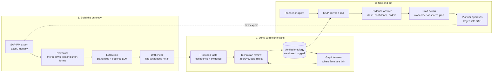

# Plant Memory PRD: maintenance knowledge ontology

Oct 11, 2026 · Akash Raj Singh · Draft v0.1

## Overview

Plant Memory turns a rice processing unit's SAP maintenance history into a verified ontology of how its equipment fails and gets fixed, and serves it to people and AI agents through an MCP server.

- **Context:** a rice processing unit (paddy cleaning, parboiling, drying, husking, milling, packing). Maintenance history lives in SAP PM and is exported to Excel.
- **Stakeholder ask:** convert work orders into an ontology, let technicians verify it, update it when new data drifts from it, and keep the knowledge when a technician leaves.
- **Product shape:** three layers (Knowledge, Reasoning, Action) on top of an evaluation harness. Every answer carries its evidence and a confidence score.
- **Status:** draft v0.1 for stakeholder review. Built as a prototype on synthetic data modeled on the SAP export.

## Problem

The plant records what parts it used, not why equipment failed or what fixed it, so diagnostic knowledge lives in technicians' heads and leaves with them.

A single month of a typical SAP PM export already shows the pattern:

- Repeat failures are invisible. One elevator can collect three separate orders in a month (bearing change, sprocket change, general maintenance), one of them issuing a large batch of bearings, sleeves and belts. Nothing links these orders as one recurring problem.
- The same parts recur across assets. The same V-belt and the same sprocket are issued on several orders across different elevators and a conveyor. Nobody can see that as a spares or design signal.
- The text is not machine-readable. Descriptions mix abbreviations and typos: "Parb.", "brg", "Plmbr Blck", "modificatn", "ELevator". Asset names ("Hodi Elevator", "Elev1&2") are embedded in free text, with no equipment ID column.
- Work-type labels are unreliable. Bearing and belt replacements are tagged Preventive, while a conveyor belt change is Corrective. Cost and reliability analysis built on these tags is skewed.
- Cause and fix are missing. The export has cost, quantity and material, but no failure symptom, root cause, downtime or action taken. That is the knowledge that walks out the door.
- Records are fragmented. One order is posted on two dates, materials are split across lines, and "Reservations by MB21" rows carry a cost center but no order number.

**Why now:** plants are starting to put AI assistants in front of planners, and an assistant can only answer from data it can read. Today the failure history is abbreviated free text in an Excel export, which neither a person nor an assistant can query with any confidence.

## Goals and success metrics

The product succeeds if a planner or agent can answer "what fails here, why, and what fixed it" with traceable evidence, and technicians trust the answer enough to sign it off.

**Goals**

1. Convert historical work orders into a verified maintenance ontology for the plant.
2. Capture technician knowledge (causes, fixes, tricks) so it survives staff turnover.
3. Keep the ontology current as new orders arrive, with humans approving every structural change.
4. Move from knowledge to decisions: what to fix first, what to stock, what to do next.
5. Prove value with a repeatable evaluation, not anecdotes.

**Non-goals (v1)**

- Replacing SAP PM or writing back to SAP automatically.
- Real-time sensor or IoT condition monitoring.
- Multi-plant rollout. One plant, one taxonomy first.
- Technician scheduling and assignment.

**Success metrics (targets for the prototype; to be confirmed)**

| Metric | What it measures | Target |
| --- | --- | --- |
| Extraction accuracy | Asset, failure mode and action correctly extracted, against a hand-labeled sample | 85% F1 or better |
| Ontology coverage | Share of work orders mapped to a valid asset and failure mode | 90% or more |
| Technician acceptance | Share of proposed facts approved without edits during review | 70% or more |
| Answer groundedness | Share of answers whose every claim cites a work order | 100% |
| Diagnostic uplift | Eval score with ontology vs. without, on a fixed question set | Clear, measurable gain |
| Time to diagnosis | Planner time to find past causes and fixes for a symptom | Under 2 minutes |

## Users and jobs to be done

| User | Role in the product | Job to be done |
| --- | --- | --- |
| Maintenance planner | Primary daily user | "When an asset fails, show me what failed before, why, and what fixed it, so I can plan the job right the first time." |
| Senior technician | Verifier and knowledge source | "Let me confirm or correct what the system learned, so my experience is recorded and credited." |
| Reliability / maintenance engineer | Analyst | "Show me which failure modes cost the most downtime and money, so I can fix root causes, not symptoms." |
| Stores / spares planner | Analyst | "Tell me which spares to stock and how many, based on real failure history." |
| Plant head | Buyer and sponsor | "Reduce repeat breakdowns and protect plant know-how when people leave." |
| AI agent / copilot | Consumer via MCP | Query the ontology with evidence instead of guessing from raw text. |

The senior technician carries the most weight: they hold most of the knowledge and are also the person who verifies it.

## Source data

The input is the SAP PM export as Excel: one row per material issue, grouped by work order. The prototype uses synthetic data that copies this structure and its messiness, never the real records.

**Existing columns (from the SAP export)**

| Column | Use in the product |
| --- | --- |
| Order | Groups rows into one maintenance event |
| Posting Date | Event timeline, recurrence and MTBF |
| Work Description | Main free-text source for asset, symptom and action |
| Material description, Material | Spare part entity and its specification |
| Cost (In Rs), Quantity, Base Unit of Measure | Event cost and consumption |
| Planning Department | Discipline (Mechanical, Electrical, Operations) |
| Work Type | Preventive, Corrective, Modification, Refurbishment (validated, not trusted) |
| Movement type | 261 = issue to order, 201 = issue to cost center, 221 = issue to project |
| G/L Account, Cost Center, Storage location | Cost rollups; low priority for the ontology |

**Columns to add (synthetic data includes them)**

| Column | Example | Why it matters |
| --- | --- | --- |
| Functional Location / Equipment ID | PARB-DRY-ELV-01 | Stable asset identity instead of names buried in text |
| Symptom / Problem description | Abnormal noise, belt slipping | Entry point for diagnosis |
| Root Cause (RCA) | Misalignment, lubrication failure, overload | The core knowledge the plant loses today |
| Cause category | Mechanical, process, operational, material quality | Grouping for Pareto analysis |
| Action Taken | Replaced, repaired, adjusted, lubricated, refurbished | Links fixes to causes |
| Downtime (hours) | 3.5 | Prioritization by impact |
| Breakdown flag | Yes / No | Separates true failures from planned work |
| Technician remarks | Free text | Tacit knowledge to capture |
| Technician assigned | Employee ID | Low priority; used only to route verification |

**Data-quality rules the pipeline must handle:** merge rows by order, reconcile one order posted on several dates, normalize abbreviations (Parb. = Parboiling, brg = bearing, Plmbr Blck = plummer block), treat cost-center reservations without an order as consumption-only, and flag work types that contradict the description.

## Ontology design

Anchored on the ISO 14224 failure taxonomy and extended for rice-processing equipment.

**Core classes**

| Class | Examples from the plant | Notes |
| --- | --- | --- |
| Process Area | Paddy cleaning, Parboiling, Drying, Husking (P2R), Milling, Warehouse | Top of the asset hierarchy |
| Asset | Dryer elevator, Hodi elevator, Paddy cleaner, Husker No.1, DM inlet pump | Has an equipment ID and an asset class |
| Component | Bearing, V-belt, sprocket, chain coupling, plummer block, screen deck | Part of an asset |
| Spare Part (Material) | BEARING 22215 EK/C3, V-BELT C-106, SPROCKET SIMPLEX 18T | Instance of a component type, with SAP material code and cost |
| Symptom | Noise, vibration, belt slip, overheating, shaft broken | What was observed |
| Failure Mode | Bearing wear, belt wear, sprocket tooth wear, shaft fracture | ISO 14224-aligned |
| Root Cause | Misalignment, poor lubrication, overload, dust ingress, moisture | From RCA columns and technician input |
| Action | Replace, repair, weld, adjust, lubricate, refurbish, modify | What was done |
| Maintenance Event | A single work order | Date, type, cost, downtime |
| Evidence | A work-order line, a technician statement | Every fact links to at least one |

**Key relations:** Asset *locatedIn* Process Area · Asset *hasComponent* Component · Spare Part *instanceOf* Component · Event *onAsset* Asset · Event *observed* Symptom · Symptom *indicates* Failure Mode · Failure Mode *causedBy* Root Cause · Event *resolvedBy* Action · Action *consumed* Spare Part · Failure Mode *recursOn* Asset · any fact *supportedBy* Evidence.

**Example facts (illustrative, from the synthetic dataset)**

- Dryer elevator *hasComponent* Bearing 22215 EK/C3 *supportedBy* a bearing-change work order.
- Dryer elevator *experienced* Sprocket wear on two orders in the same month *supportedBy* both orders.
- Bran room shaft *experienced* Shaft fracture, *resolvedBy* Weld repair *supportedBy* the repair work order.

**Every fact carries metadata:** confidence score (0 to 1), evidence count, source (extracted, technician-stated, inferred), and a verification state: *Proposed → Verified* or *Rejected*, with who verified it and when. Only verified facts count as high-confidence in answers.

## User flow

1. **Ingest:** the monthly SAP PM export is loaded, rows are merged by order, and plant short forms are expanded.
2. **Extract and check drift:** plant rules extract asset, component, symptom, cause and action, with an optional LLM as a second reader; terms that do not fit the current ontology become drift proposals.
3. **Review:** technicians approve, edit or reject proposed facts, lowest confidence first. Drift proposals also need an engineer's approval.
4. **Verify and fill gaps:** approved facts enter the versioned ontology. Where facts are thin or conflicting, a gap interview asks a technician targeted questions, and the answers go back through review.
5. **Use:** a planner or agent asks through the MCP server or CLI and gets a claim with its confidence and source orders.
6. **Act:** drafted work orders or spares plans go to the planner for approval, are keyed into SAP, and appear in next month's export.

## Functional requirements

Requirements are grouped by the three product layers plus the evaluation harness; P0 is in the MVP.

### Knowledge layer

| ID | Requirement | Priority |
| --- | --- | --- |
| K1 | Ingest SAP PM Excel/CSV exports; merge rows into one event per order; keep raw rows as evidence | P0 |
| K2 | Normalize text: expand plant abbreviations, fix common typos, resolve asset aliases ("Elev1&2", "Hodi Elevator") to equipment IDs | P0 |
| K3 | Extract asset, component, symptom, failure mode, root cause and action from each event (rules first, optional LLM second reader); map to the ontology's classes | P0 |
| K4 | Attach a confidence score and evidence links to every extracted fact | P0 |
| K5 | Technician verification queue: approve, edit or reject proposed facts, lowest confidence first; record who verified and when | P0 |
| K6 | Flag contradictions, such as a work type of Preventive on a breakdown, or two different root causes for the same event | P1 |
| K7 | Knowledge-gap interviewing: where facts are sparse or conflicting, generate short targeted questions for a named technician and write the answers back as technician-stated evidence | P1 |
| K8 | Ontology drift detection: when new orders do not fit existing failure modes or causes, propose a new class or relation for approval; never change structure without a human | P1 |
| K9 | Version the ontology; every structural change is logged and reversible | P1 |

### Reasoning layer

| ID | Requirement | Priority |
| --- | --- | --- |
| R1 | Failure history per asset: events, failure modes, causes, actions, cost, over time | P0 |
| R2 | Root-cause suggestions for a symptom on an asset, ranked by evidence and confidence | P0 |
| R3 | Bad-actor ranking: failure modes and assets ranked by cost, frequency and downtime (Pareto view) | P0 |
| R4 | Recurrence detection: flag repeat failures on the same asset within a set window | P1 |
| R5 | Cross-asset patterns: same component failing across similar assets | P1 |
| R6 | Basic reliability stats: MTBF and cost per failure mode where data allows | P2 |

### Action layer

| ID | Requirement | Priority |
| --- | --- | --- |
| A1 | Spare-parts intelligence: recommend critical spares and minimum stock from failure frequency and consumption history | P1 |
| A2 | Draft a follow-up work order: suspected cause, recommended action, parts list with SAP material codes; planner must approve | P1 |
| A3 | Suggest preventive-maintenance changes where a failure mode recurs before its PM interval | P2 |
| A4 | Export drafts in a format SAP users can key in or upload (no automatic write-back in v1) | P2 |

### Evaluation harness

| ID | Requirement | Priority |
| --- | --- | --- |
| E1 | Hand-labeled gold set of work orders for extraction accuracy | P0 |
| E2 | Fixed set of diagnostic questions answered by an agent with and without the ontology; scored for correctness and groundedness | P0 |
| E3 | Regression run after every ontology or prompt change | P1 |

### Cross-cutting: evidence and confidence

Every answer, from every tool and screen, returns the claim, its confidence, the supporting work orders or technician statements, and a sparse-evidence warning when fewer than a set number of events support it. No answer is shown without evidence.

## MCP server and CLI

The same capability set ships as an MCP server for agents and a CLI for planners, from one core.

| Tool | Input | Returns | Layer | Priority |
| --- | --- | --- | --- | --- |
| `get_asset_history` | asset or equipment ID, date range | Events, failure modes, causes, actions, cost | Knowledge | P0 |
| `suggest_root_causes` | asset, symptom | Ranked causes with confidence and evidence | Reasoning | P0 |
| `find_similar_failures` | free-text problem description | Past events that match, with their fixes | Knowledge | P0 |
| `rank_bad_actors` | process area, period, metric (cost, frequency, downtime) | Pareto list of assets and failure modes | Reasoning | P0 |
| `get_evidence` | fact ID | Source work-order lines and technician statements | Knowledge | P0 |
| `recommend_spares` | asset or process area | Critical spares, suggested minimum stock, rationale | Action | P1 |
| `draft_work_order` | asset, symptom | Draft order with cause, action, parts list; status Draft | Action | P1 |
| `list_knowledge_gaps` | asset or technician | Open questions waiting for technician input | Knowledge | P1 |
| `submit_technician_answer` | question ID, answer | Proposed fact entering the verification queue | Knowledge | P1 |
| `list_drift_proposals` | none | New classes or relations awaiting approval | Knowledge | P1 |

**Rules for the server:** read tools are open to any connected agent; write tools (`submit_technician_answer`, `draft_work_order`) create proposals only and never change verified facts. Every response carries confidence and evidence IDs.

## Non-functional requirements

- **Traceability:** every fact and answer links to source rows; nothing is shown without evidence.
- **Human control:** no structural ontology change and no work order leaves Draft without human approval.
- **Data residency:** maintenance data is proprietary; support on-premise or private-cloud deployment, and no data sent to third-party services without the plant's consent.
- **Usability on the shop floor:** the verification queue works on a phone, takes under 30 seconds per fact, and supports Hindi and English.
- **Performance:** MCP read tools respond in under 3 seconds on a history of 50,000 work-order lines.
- **Auditability:** ontology versions and verification decisions are logged and reversible.
- **Access control:** role-based access; technicians verify, planners draft, engineers approve drift proposals.

## Release plan

MVP goal: show, on one process area, that an agent using the ontology answers diagnostic questions better than one reading raw work orders, and cites the orders it used.

1. **MVP: parboiling elevators and conveyors.** Ingest, normalize, extract (K1 to K5), five P0 MCP tools, bad-actor Pareto view, evaluation harness (E1, E2). Synthetic dataset of 12 months modeled on the SAP export.
    - Gate: extraction F1 of 85% or better on the gold set and a measurable uplift on the eval question set.
2. **Phase 2: living ontology.** Knowledge-gap interviewing, drift detection, contradiction flags, versioning (K6 to K9), recurrence and cross-asset patterns (R4, R5).
    - Gate: technicians approve 70% or more of proposed facts without edits.
3. **Phase 3: decisions and actions.** Spare-parts recommendations, work-order drafting, PM interval suggestions, SAP-ready export (A1 to A4), reliability stats (R6).
    - Gate: planners accept drafted work orders with minor edits in most cases.
4. **Later:** extend to milling, husking and utilities; then a second plant, testing whether the ontology transfers.

## Risks, assumptions and open questions

**Risks**

| Risk | Impact | Mitigation |
| --- | --- | --- |
| Historical orders lack root cause and symptom | Ontology is thin exactly where it matters | Knowledge-gap interviewing fills it; start with assets that have the most orders |
| Technicians do not engage with verification | Facts stay unverified; trust stays low | Phone-first queue, under 30 seconds per fact, credit technicians by name in answers |
| LLM extraction errors | Wrong facts look authoritative | Confidence scores, evidence on every answer, human verification before facts count as verified |
| Ontology over-engineered for one plant | Slow to build, hard to maintain | Anchor on ISO 14224; add classes only through drift proposals |
| Data sensitivity | Plant refuses cloud processing | On-prem option; synthetic data for the prototype |
| Incumbent overlap (SAP, Maximo, Palantir) | "Why not use what we have?" | Read SAP exports and leave SAP as the system of record; Plant Memory only adds the failure knowledge on top |

**Assumptions**

- SAP PM exports can be scheduled monthly, and functional locations exist even if not in this export.
- At least two senior technicians can give about 30 minutes a week to verification.
- Downtime can be estimated per event where it is not recorded.

**Open questions**

- [ ] Is a functional location or equipment ID available in SAP for these orders?
- [ ] Does the plant record RCA for every breakdown or only major ones?
- [ ] Which process area should the MVP cover: parboiling elevators, or another with more breakdowns?
- [ ] Who approves ontology drift proposals: the maintenance head or a reliability engineer?

## Addendum v0.2: from prototype to product (Oct 12, 2026)

The MCP server proved the knowledge layer. v0.2 makes it usable by people and by other plants, on the same core, so the web app, CLI and MCP server always agree.

**Decisions**

| Topic | Decision | Why |
| --- | --- | --- |
| Interfaces | One core, three interfaces: web app (people), MCP server (agents), CLI (automation) | Technicians verify in the browser, agents read the verified graph, and the CLI covers scripting |
| Editing | Raw uploaded rows are read-only evidence; people edit facts (verify, correct, reject), assets and vocabulary; "delete" means reject; all decisions are audited | Traceability is the product's promise; editing evidence would break it |
| Configurability | Column mapping per upload; asset discovery from functional locations and descriptions; editable asset register and vocabulary | Without it, only the demo plant's export would load correctly |
| Ingestion | Background jobs with progress; every uploaded file is a source; the graph is rebuilt from all sources, newest file wins per work order; LLM results cached | Free-tier LLM extraction takes minutes; monthly exports must add to history |
| Graph view | Our own view with Cytoscape.js (MIT), fed by our API, with filters and an evidence panel | Neo4j's NVL library is licensed only for Aura or commercial Neo4j; embedding Neo4j Browser gives no review actions and no SQLite support |
| Privacy | Three modes: local only (rules), LLM API (OpenAI-compatible, Groq default), local LLM (e.g. Ollama); shown before upload | Maintenance records are proprietary; the plant decides where text goes |
| LLM role | Second opinion: rules win disagreements, which lower confidence and raise review priority; LLM fills gaps except components | Measured: the LLM was less accurate than the rules on every field as an independent extractor (docs/llm_evaluation.md) |
| Packaging | `pip install` + `python -m plant_memory serve`, or `docker compose up` with Neo4j | A stranger can try it in five minutes |

**Screens:** Overview (bad actors, repeat failures, spares, data quality) · Upload (choose file → match columns → confirm assets → build) · Review (facts, technician questions, new terms) · Graph (patterns and individual work orders) · Work orders (table + read-only SAP evidence + fact review) · Assets & terms · Privacy & settings.

**Out of scope for v0.2:** sign-in and roles, multi-plant workspaces, write-back to SAP, server-side paging for very large histories.

**Specified above but not built yet:** `draft_work_order` and work-order drafting (A2), PM interval suggestions (A3), SAP-ready export (A4), MTBF stats (R6), ontology versioning with rollback (K9; decisions are audited but not reversible), a phone-first review queue, Hindi UI, and role-based access. Contradiction flags (K6) cover only breakdowns tagged Preventive.
